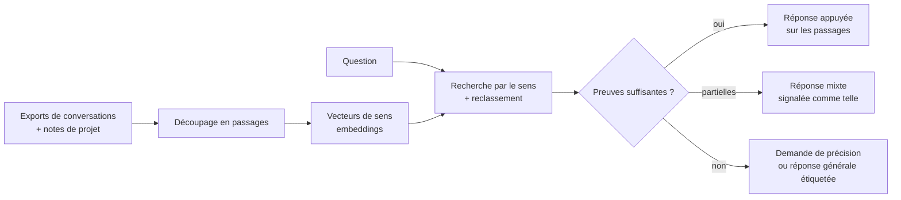

# MEL_IA — étude de cas

> Interroger en langage naturel ses propres historiques de conversations avec des IA et ses notes de projet, **en local**, avec des réponses qui s'appuient sur les passages retrouvés — et qui disent « je ne sais pas » quand la mémoire ne suffit pas.

**Statut** : projet personnel en Python, versionné. Seul utilisateur : moi.
**Ce dépôt documente la conception, les mesures et les décisions. Le code et les données restent privés.**
**Période** : 2025 – 2026.

---

## 1. Le problème

On produit beaucoup de texte avec des assistants IA : des centaines de conversations sur plusieurs services, réparties en exports séparés. Une fois la conversation fermée, on ne retrouve plus *pourquoi* une décision a été prise, ni quelle solution avait été essayée. Les moteurs de recherche des interfaces ne cherchent que dans un service, et par mots exacts.

**Contraintes que je me suis fixées**
- **Local** : ces conversations contiennent des choses personnelles. Rien ne doit partir à l'extérieur pour répondre.
- **Honnête** : une réponse fausse mais fluide est pire qu'une réponse « introuvable ».
- **Vérifiable** : voir d'où vient une réponse.

## 2. Le principe

Un passage est retrouvé par son **sens** et non par ses mots exacts, puis un second modèle reclasse les meilleurs candidats. Ensuite un petit modèle de langage local rédige la réponse à partir de ces seuls passages.

## 3. Décisions de conception

**Le routeur décide avant de répondre.** Selon la qualité des preuves retrouvées (score du meilleur passage, écart avec le suivant), le système choisit un mode : réponse **strictement appuyée** sur la mémoire, réponse **mixte**, réponse **générale étiquetée**, ou **demande de précision**. Sans preuve, il ne devine pas.
Les seuils sont posés à la main et marqués « à ajuster » dans le code : c'est un premier réglage, pas un résultat.

**L'agent a des outils, avec des garde-fous.** Foxy (l'interface) peut lire la mémoire, lire des fichiers, lister, et écrire une note qui est réingérée.
- les lectures sont **limitées à des racines autorisées** ;
- l'écriture est déclarée **destructive** et bloquée si la demande ne vient pas de l'utilisateur ;
- une **sentinelle** filtre le contenu externe suspect avant qu'il n'atteigne l'agent (anti-injection).

**La fidélité prime sur le taux.** Pour un sous-agent chargé de résumer l'historique d'une conversation longue, la consigne écrite est : ne jamais jeter une décision, un chiffre, une entité, une question ouverte, un blocage et sa résolution ; en cas de doute, **garder**. Le plafond de réduction est volontairement limité, car comprimer davantage fait perdre l'essentiel.

**Local par défaut.** Embeddings, reclassement et génération tournent sur la machine.

## 4. Évaluation : comparer à une alternative

J'ai comparé MEL_IA à un autre système de mémoire (recherche mixte mots-clés et sens, indexé sur les sessions de Claude Code), sur des questions écrites à la main.

| Série | Questions | MEL_IA (R@5) | Alternative (R@5) | Latence moyenne |
|---|---|---|---|---|
| v1 (juin 2026) | 20 | 60 % | 80 % | 16 s contre 3,8 s |
| v2 | 30 | 70 % | 73 % | 13 s contre 3,9 s |

*R@5 : la bonne information figure parmi les 5 premiers passages retournés.*

**Ce que j'en ai conclu.** Le bon passage est plus souvent retrouvé par l'alternative, et nettement plus vite. Mais **les deux ne couvrent pas les mêmes contenus** : l'une indexe les connaissances du projet, l'autre les sessions de code. Recommandation écrite : **ne pas migrer**, les faire fonctionner en complément.

### Les échecs, un par un

Le rapport détaille chaque question ratée et sa cause probable, pour les deux systèmes.

| Cause | Exemple | Suite |
|---|---|---|
| Corpus trop étroit | Des projets entiers n'étaient pas indexés | Piste : élargir les sources |
| Latence | Le vecteur de la question est recalculé à chaque requête ; un délai a été dépassé | Piste : cache des vecteurs de question, délai relevé |
| Accents | « createur » ne retrouvait pas « créateur » | **Corrigé** : normalisation à l'ingestion et à la requête |
| Découpage | Deux termes précis rarement dans le même passage | Piste : passages plus larges |

L'alternative a aussi ses échecs (casse, tirets, termes rares). Ils sont documentés de la même façon.

## 5. Ce que la mesure ne dit pas

- **La métrique est un proxy** : un passage est jugé bon s'il contient des mots-clés attendus. Ça ne mesure pas que le contenu *répond* à la question.
- **Les questions sont écrites par moi**, sur mon propre corpus, avec un biais évident.
- **20 puis 30 questions** : un ordre de grandeur, pas une statistique. L'écart entre 70 % et 73 % n'est pas significatif.
- **Le comportement de l'agent n'a pas de jeu d'évaluation** : ni le routeur, ni les garde-fous ne sont mesurés.
- **Le juge de fidélité du sous-agent de résumé n'est pas mesuré** : un petit jeu de 20 à 30 cas est prévu.

## 6. Limites assumées

- **Aucun utilisateur autre que moi** : pas d'entretien, pas de retour, pas de métriques d'usage.
- **Un seul service ingéré** pour l'instant : les autres exports restent à récupérer.
- **Les seuils du routeur** ne sont pas calibrés.
- **Les documents de spécification** sont orientés exécution (consignes pour un assistant de code), pas cadrage produit.
- **Le périmètre a dérivé vers l'infrastructure** (synchronisation, conteneurs, embeddings) au détriment de la question initiale.

## 7. Suite

1. Réindexer les passages avec le modèle d'embedding retenu, pour que la recherche soit cohérente avec le code.
2. Mesurer le routeur sur un petit jeu de questions étiquetées.
3. Brancher le sous-agent de résumé avec un juge de fidélité.
4. Répéter la comparaison avec un jugement de pertinence, pas seulement des mots-clés.

## 8. Ce que ce projet m'a appris

1. **Décider quand ne pas répondre** est une fonctionnalité de produit, pas un détail technique.
2. **Comparer à une alternative** révèle que la bonne question n'est pas « lequel est meilleur » mais « pour quel contenu ».
3. **Documenter chaque échec avec sa cause** transforme un mauvais score en liste de corrections.
4. **Un proxy bien choisi n'est pas une preuve** : savoir ce que la métrique ne mesure pas compte autant que le chiffre.

---

*Implémentation assistée par IA ; j'ai défini le besoin, les contraintes, les garde-fous et les critères de comparaison, et j'ai relu et décidé à partir des résultats.*
